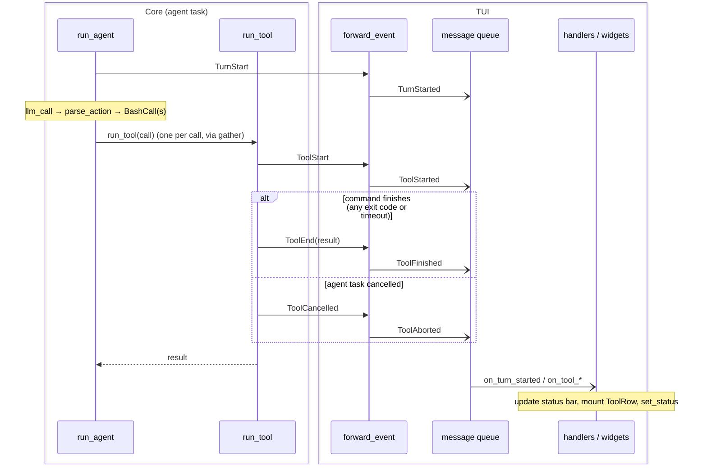
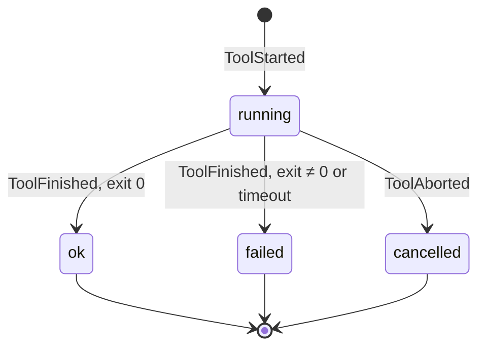

# How events travel between layers

The core (`agent.py`) knows nothing about any UI. It reports progress through
one callback, `on_event`, which must return immediately. Each front end supplies
its own callback: `print_event` for the CLI, `AgentApp.forward_event` for the TUI.

## Sequence: one turn, one tool call (TUI)

Solid arrows (`->>`) are plain function calls on the agent's task, made through
`emit()`, which swallows exceptions so a broken front end can't crash the agent.
Open arrows (`-)`) are fire-and-forget. `post_message` only enqueues, and the
handlers run later on Textual's own loop. That queue is the boundary between
the two layers.

## State: one ToolRow

`status_for(result)` alone decides between `ok` and `failed`. Each state is a
CSS class on the row.
